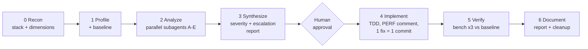

# Slides outline (14 + 3 backup)

Keep the deck thin: the live agent is the show. Slides only cover the moments when the screen
would otherwise be empty (the opening, the workflow walk-through, the recap), plus backups for
when a live step fails. **Bold** slides are the ones you actually show. The others are optional
or backup. The segment numbers match [run-of-show.md](run-of-show.md).

| # | Segment | Title | Visual | Speaker note |
|---|---|---|---|---|
| **1** | 1. Hook | From 10 req/s to 11.11-ready | Title, your name, repo URL | "An agent, a workflow, and a service that falls over at 16 users." |
| **2** | 1. Hook | 11.11 is six weeks away | The 4 readiness targets (table below) | "Marketing expects 10× traffic. These are the numbers we must hit." |
| **3** | 1. Hook | Today: 0/4 | Screenshot of `npm run bench:quick` at baseline (~10 req/s, p95 in seconds) | Show it live instead if the laptop is ready; the slide is the backup. |
| **4** | 3. Why a workflow | "Make it faster" is not a plan | Four failure modes: guessing the hot spot, optimizing the wrong layer, breaking invariants, no proof | "An agent will happily do all four, fast." |
| **5** | 3. Why a workflow | `/perf-optimize` in one picture | Phase diagram (mermaid below) | Walk it in about 60 seconds. Stress *measure first* and *the human gate*. |
| **6** | 3. Why a workflow | Guardrails the agent must respect | README "Operational requirements" 1–6, with SEC-112 highlighted | "Fast but wrong is worse than slow. These are enforced by tests, and one of them only by you." |
| 7 | 4. Evidence | Evidence, not guesses | Hot-lines table: `JSON.parse(readFileSync)` 47.9%, ~40 MB allocated per request | Backup for when you can't open `.profiles/baseline/summary.md` live. |
| 8 | 5. Parallel analysis | Five lenses in parallel | A CPU · B Memory · C I/O · D Concurrency · E Serialization, one line each | Talk over the subagent panel. |
| 9 | 6. Report + approval | Severity, escalation, and "no" | A report excerpt: CRITICAL catalog parse (3+ dimensions), Skip list | "The workflow's most underrated feature is the Skip column." |
| **10** | 8. Verify + ship | The staircase | Bar chart of mixed req/s: 10 → 31 → 120 → ~600–700, readiness 0/4 → 4/4 | Build it from your own Phase 5 numbers if you can; otherwise use [staircase.md](../solution/results/staircase.md). |
| 11 | 5. Parallel analysis (traps) | 7 tempting shortcuts, 7 red builds | Output of `try-naive --all` | Backup for the live naive-fix demo. "Load-once caches, auth caches that skip revocation, Promise.all everything: all caught." |
| **12** | 9. Bottleneck moves | The bottleneck moves | Before/after hot lines: `catalog-repository.js:15` 48% → `promotions.js:8` 18.5%, plus the heap climbing 37 → 55 MB | "Fixing the CPU exposed the next problem. It's already in the report's backlog." |
| **13** | 10. Recap | Three takeaways | 1. Evidence before edits · 2. A workflow turns an agent into a disciplined engineer · 3. Guardrails make speed safe | — |
| **14** | 10. Recap | Try it on Monday | `github.com/irahardianto/awesome-agv` → copy `.agents/` → `/perf-optimize` · workflows become skills on Nov 1, 2026 (`/migrate-workflows`) | Leave this up during Q&A. |
| B1 | Backup | Reference numbers | The full staircase table from [staircase.md](../solution/results/staircase.md) | If the live bench misbehaves. |
| B2 | Backup | A safe auth cache | Design of fix 3: digest-keyed, bounded LRU + TTL, never caches failures, status checked every request, KDF untouched | For the "isn't that insecure?" question. |
| B3 | Backup | Run this workshop yourself | Kit layout, `npm run doctor`, `npm run reset -- --yes` | For attendees who want to repeat it. |

## Slide 2: targets table

| Scenario | 11.11 target (16 concurrent connections) |
|---|---|
| search | p95 ≤ 100 ms |
| product | p95 ≤ 50 ms |
| cart | p95 ≤ 150 ms |
| mixed | ≥ 250 req/s and p95 ≤ 150 ms |
| all | event-loop p99 ≤ 50 ms, no errors |

## Slide 5: the workflow

## Slide 10: staircase data (reference fixes, rehearsal machine, full bench, mixed scenario)

| After | mixed req/s | mixed p95 | Readiness |
|---|---:|---:|---|
| baseline | 10 | 5.2 s | 0/4 |
| fix 1: catalog cache | 31 | 2.0 s | 0/4 |
| fix 2: search index | 120 | 531 ms | 0/4 |
| fix 3: auth cache | 596–702 | 93–107 ms | 4/4 |
| fix 3 alternative: async PBKDF2 (rehearsal 1) | 370 | 124 ms | 3/4 (cart p95 ~155 ms) |

## Visual style tips

- One number per slide in huge type beats a table: **10 → 600 req/s**, **0/4 → 4/4**,
  **48% → 0%**.
- Use the terminal's own output for screenshots (dark theme, large font). It reads as authentic.
- Avoid slides during segments 4–8. The audience should be watching the agent.
